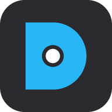
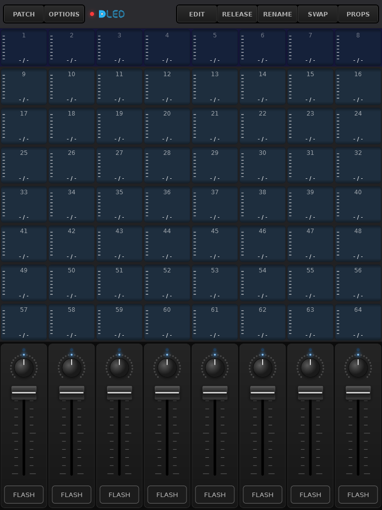
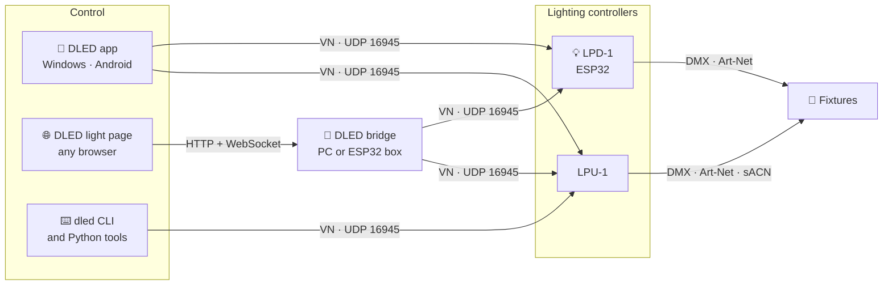
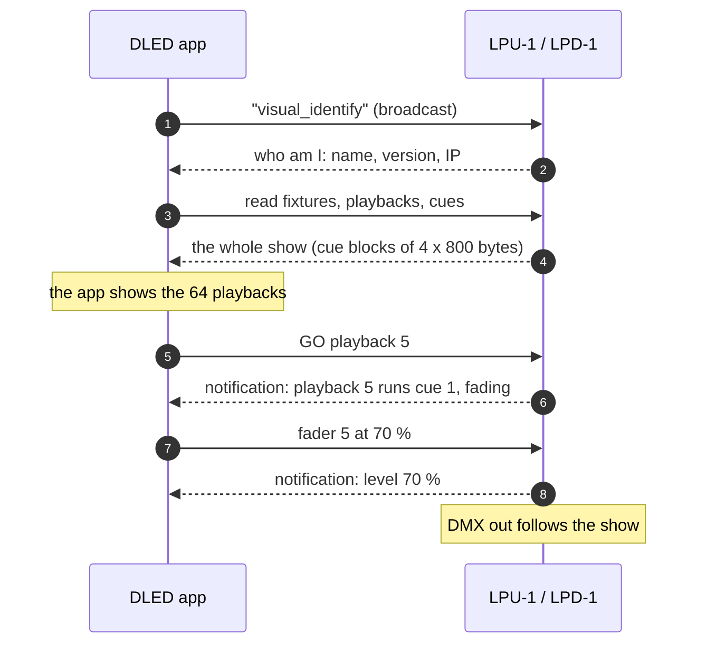
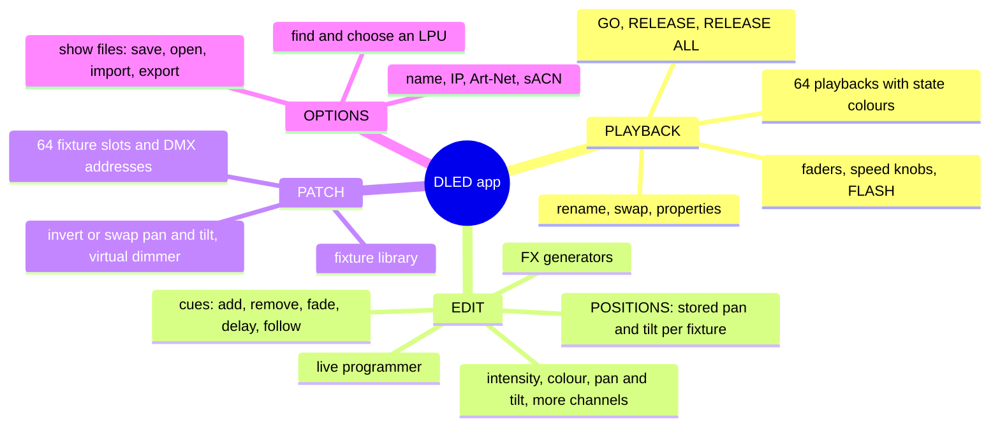
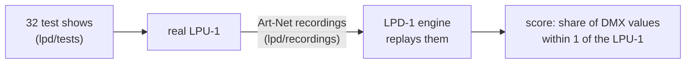

<p align="center">
  
</p>

<h1 align="center">DLED / LPD-1</h1>

<p align="center">
  Open tools to program and play the <b>LPU-1</b> lighting controller over the network,<br>
  and an ESP32 device that speaks its protocol.
</p>

<p align="center">
  <a href="LICENSE"></a>
  
  
  
</p>

---

## What is this?

The LPU-1 is a small stand-alone DMX lighting controller: it holds a show of
up to 64 fixtures and 64 playbacks and plays it on its DMX output, Art-Net
and sACN. It is programmed over Ethernet with an app.

**DLED** is an independent, open-source set of tools that talk to the LPU-1
on the network:

| | Part | What it does |
|---|---|---|
| 📱 | **DLED app** (`dled_flutter/`) | Program and play the LPU-1 from Windows, Android or a browser: playbacks, cues, a live programmer with FX, fixture patch, stored positions, show files |
| 🌐 | **DLED light page** (`dled_flutter/light/`) | The same app as a small web page for any phone or tablet browser |
| 🔌 | **DLED bridge** (`dled_flutter/bin/`, `firmware/dled_bridge/`) | Serves the light page and passes its traffic to the LPU, on a PC or on a small ESP32 box |
| 💡 | **LPD-1** (`firmware/lpd1/`) | An ESP32 device that speaks the LPU-1's protocol and computes the DMX itself: the apps work with it as with an LPU-1 |
| 🔬 | **Protocol notes and tools** (`analysis/`, `lpd/`) | How the protocol and the `.show` format work, a Python library, an emulator, and DMX measurements |

<p align="center">
  
  <br><sub>The DLED app's PLAYBACK page (not connected): 64 playbacks, a row of faders, speed knobs and FLASH buttons.</sub>
</p>

> DLED is not affiliated with or endorsed by the maker of the LPU-1. The
> device's name is used only to say what these tools work with. In the code
> and notes, **"the reference app"** means the app that comes with the
> LPU-1; DLED was tested against it so both can be used side by side.

## Compatibility and where DLED is going

| | with an LPU-1 | with an LPD-1 |
|---|---|---|
| **DLED app and light page** | ✅ everything the LPU-1 can do | ✅ the same, plus new DLED features as they come |
| **The reference app** | ✅ (its own app) | ✅ the LPU-1 features; not the new DLED features |

- **Version 1.x is fully LPU-1 compatible.** Everything in DLED today works
  with an LPU-1, and the LPD-1 behaves like one. The release tagged
  [`v1.0`](https://github.com/tobios123/dled/releases/tag/v1.0) is that
  state, and stays available as it is.
- **From 2.x the LPD-1 gets features of its own.** They are added on top of
  the LPU-1 protocol, not in place of it. The app checks what it's talking
  to (the LPD-1 reports its name and version when it's found) and offers a
  new feature only where the device has it. With an LPU-1 the app keeps
  working as in 1.x.
- Features that need an LPD-1 will be marked **LPD-1 only** in this README
  and in the app.

## How the pieces fit



A browser cannot send UDP, so the light page talks to a **bridge** over a
WebSocket and the bridge sends the datagrams. The app and the CLI talk to
the device directly.

## A session, step by step



Every write is echoed by the device, and every change (from any app) is
sent as a notification, so all connected apps stay in step. The full
protocol is in [`analysis/FINDINGS.md`](analysis/FINDINGS.md) (section 20)
and [`dled_flutter/VN_PROTOCOL.md`](dled_flutter/VN_PROTOCOL.md).

## What we found

The short version of the protocol and engine notes. Each point links to the
details.

- **One UDP port for everything.** Apps find the LPU-1 with a broadcast
  (`visual_identify`) and then talk to it on UDP 16945. Every message is a
  20-byte header (which object: fixture, playback or cue; which property;
  up to three indexes) plus a value. Every write is echoed, and every
  change is pushed to all apps as a notification.
  ([FINDINGS](analysis/FINDINGS.md) sections 1 and 20)
- **A show is 64 fixtures and 64 playbacks of up to 48 cues.** Each cue is
  stored as 4 blocks of 800 bytes, one value per fixture attribute. The app
  reads and writes the show block by block.
  ([SHOW_DOWNLOAD_FLOW](analysis/SHOW_DOWNLOAD_FLOW.md))
- **49 cues hang the LPU-1.** Writing a 49th cue into a playback stops the
  device answering until a power cycle. DLED refuses such a show before
  sending anything. ([DMX_ENGINE](lpd/DMX_ENGINE.md) section 12a)
- **A fixture is a string of function codes**, two hex digits per DMX
  channel (`01` intensity, `02` pan, `04` red ...). Code `00` ends the
  fixture, and a fine channel is its code + `20`.
  ([FINDINGS](analysis/FINDINGS.md) section 3)
- **Cue values are 16 bits**, little-endian. Pan and tilt are signed around
  the centre. ([DMX_ENGINE](lpd/DMX_ENGINE.md) section 2)
- **DMX out:** Art-Net and sACN together, 40 frames a second, always all 512
  channels. A GO shows up 1 to 4 frames later.
  ([DMX_ENGINE](lpd/DMX_ENGINE.md) section 1)
- **The playback fader dims only intensity**; colour and position stay. FX
  (intensity, colour, position) follow fixed wave shapes with a phase
  spread over the fixtures, and the speed knob scales them.
  ([DMX_ENGINE](lpd/DMX_ENGINE.md) sections 3 to 7)
- **`.show` files are XML.** The reference app opens the files DLED writes,
  but drops sections it doesn't know. That's why DLED keeps stored
  positions in a file of their own next to the show.

## Features



- **Live:** every slider, GO and fader goes to the device at once, and changes
  made elsewhere show up in the app.
- **Show files:** `.show` files that the reference app opens as well.
- **Positions:** store the aim of every moving head on a tile and recall it
  in any cue, per fixture (saved next to the show as `NAME.positions.json`).
- **No pop-ups:** the app never interrupts a show with messages.

## Repository map

```text
dled_flutter/        the app (Flutter), the light page, the CLI and the PC bridge
  tool/                light page build, icons, fixture library tool
  lib/core/            protocol, .show files, cue records: pure Dart, shared by all
  lib/screens/         PLAYBACK, EDIT, POSITIONS, PATCH, OPTIONS
  light/               the light page (HTML / JS / CSS + the shared Dart as JS)
  bin/                 dled_cli.dart, dled_bridge.dart
  test/                the app's tests
firmware/
  lpd1/                LPD-1: DMX engine (C++17), VN server, ESP32 board code, tests
  dled_bridge/         the DLED bridge on an ESP32 (WT32-ETH01)
analysis/            protocol notes, Python library (analysis/lpu), tools, tests
lpd/                 DMX measurements of the LPU-1 and the tests behind them
samples/             example .show files
docs/images/         pictures for this README
.claude/skills/      Claude Code skills (see "Claude Code skills" below)
```

## Getting started

### The app

Needs [Flutter](https://docs.flutter.dev/get-started/install) 3.x.

```bash
cd dled_flutter
flutter test
flutter run -d windows
```

`flutter build apk` builds the Android app. On Windows, saved shows go to
`Documents\DLED\shows`. Open **OPTIONS**, choose your LPU in the list, and
the app downloads its show.

### The light page in a browser

```bash
cd dled_flutter
dart run tool/build_light.dart
dart run bin/dled_bridge.dart --web light/dist --port 8081
```

Open `http://<this PC>:8081` on a phone or tablet in the same network.
For a stand-alone box, flash `firmware/dled_bridge` to a WT32-ETH01 (see the
notes at the top of its `platformio.ini`); it then serves the page at
`http://dled.local`.

### The command line

```bash
cd dled_flutter
dart run bin/dled_cli.dart discover
dart run bin/dled_cli.dart status --ip 192.168.1.12
dart run bin/dled_cli.dart download --ip 192.168.1.12 --show backup.show
```

Also `info`, `go`, `flash`, `release`, `release-all`, `upload` (a dry run until
`--yes`, then backup, upload and read-back check), `playback`, `set`,
`monitor` and `show`. On Windows, `dled.cmd` runs it from any folder.

### LPD-1

Needs [PlatformIO](https://platformio.org/). The engine's tests run on a PC
(with gcc):

```bash
cd firmware/lpd1
python -m platformio test -e native
python -m platformio run -e wt32-eth01
```

Wiring and the first flash: [`firmware/lpd1/FIRST_FLASH.md`](firmware/lpd1/FIRST_FLASH.md).
Later updates go over the network (`-e wt32-eth01-ota`).

### Python library and tools

```bash
python -m unittest discover -s analysis/tests
python analysis/scripts/lpu_emulator.py --show samples/64fixtures.show
```

Python 3.9+, standard library. [`analysis/LPU_TOOLS.md`](analysis/LPU_TOOLS.md)
lists the tools; the emulator is a fake LPU-1 for trying things without
hardware.

## Claude Code skills

The repository comes with five skills for
[Claude Code](https://claude.com/claude-code), in `.claude/skills/`. Open
the repository in Claude Code and they are there. Ask in plain words (for
example "what's on my LPU?") or call one by name (`/lpu-show-read`).

| Skill | What it does |
|---|---|
| `lpu-show-read` | Explains a `.show` file: the patch with every DMX channel named, the playbacks and their options, and every cue with its values and FX |
| `lpu-show-download` | Downloads the show from an LPU-1 into a `.show` file and/or a readable report, e.g. as a backup |
| `lpu-show-upload` | Puts a `.show` onto an LPU-1: a dry run first, then a backup of what's there, the upload, and a read-back check |
| `lpu-personality-add` | Adds a fixture to the library from QLC+, Avolites, grandMA or Freestyler files or a PDF manual, and shows you the result before writing it |
| `vn-capture-decode` | Turns a capture of LPU-1 traffic (`.pcapng`, or live) into readable lines: which button, fader or write it was |

Uploading replaces the whole show on the device, so the upload skill always
asks before it sends anything.

## Fixture library

PATCH picks fixtures from `dled_flutter/assets/personalities.xml`: per
manufacturer the models and their modes, one function code per DMX channel.
This repository ships one made-up example (**Generic RGBW Par**, 4 ch and
8 ch). Add your own fixtures:

```bash
python dled_flutter/tool/personality_add.py read FOLDER > spec.json
python dled_flutter/tool/personality_add.py add spec.json --write
```

It reads QLC+, Avolites, grandMA and Freestyler fixture files. A fuller
library of your own can live next to it as `personalities.local.xml` (not
in Git): the app, the light page and the tools use it when it is there.

## How DLED was made

DLED follows what the LPU-1 does, measured on a real device: the network
traffic between an app and the LPU-1 (for the protocol and the `.show`
format) and the LPU-1's DMX output for 32 test shows (for the LPD-1's
engine, see [`lpd/DMX_ENGINE.md`](lpd/DMX_ENGINE.md)). This is done for
interoperability, so DLED and the reference app can be used together on the
same device.

## What we tested



- **The LPD-1 against a real LPU-1.** 32 test shows were run on an LPU-1,
  covering cues, fades, follow and go modes, FX, the fader, the programmer,
  more than one playback, and 64 fixtures. Its DMX output was recorded each
  time. The LPD-1's engine replays every recording and matches 99.9 to 100 %
  of the values. The rest is moments where the LPU-1 itself acted oddly.
- **Automated tests:**
  - 248 for the app (protocol, `.show` files, cue records, the CLI against
    the emulator);
  - 44 for the LPD-1 (the engine replays and the protocol server);
  - 23 for the Python library.

  The commands are under [Contributing](#contributing).
- **Against the reference app:** shows saved by DLED open in it.
- **Show upload and download on the device:** the upload tools (CLI and
  skill) read the show back after every upload and compare it. A completely
  full show (64 playbacks x 48 cues) was written, and a sample of it was
  read back.
- **Stored positions:** stored and recalled on a real LPU-1. The LPD-1 gives
  the same cue records.
- **Not tested:** the Android, iOS and macOS builds of the app. Testing was
  done with the Windows app and the light page in a browser.

## Contributing

Issues and pull requests are welcome. Please run the tests of the part you
change (`flutter test`, `python -m platformio test -e native`,
`python -m unittest discover -s analysis/tests`). Do not add your own
network captures, other people's files or fixture libraries you may not
share. (The tests' reference frames in `dled_flutter/test/core_data/` are
small decoded samples the tests need.)

## Credits and third-party code

**Code that DLED follows:**

- **DMX output of the LPD-1** (`firmware/lpd1/lib/dmxout`): it sends DMX the
  way [WLED](https://github.com/wled/WLED) does in its
  `wled00/src/dependencies/dmx/SparkFunDMX.cpp`, by SparkFun Electronics
  and the WLED project, under the MIT licence:
  - UART2, TX on GPIO 2 to a MAX485;
  - 250 kbaud 8N2;
  - the break made by sending a 0 byte at 83 333 baud.

  Unlike that code, DLED's version doesn't wait for a frame to finish
  sending.

**Libraries and tools, downloaded when you build (not in this repository):**

| Used by | What | Licence |
|---|---|---|
| App | [Flutter](https://flutter.dev) and Dart | BSD-3-Clause |
| App | provider, xml, file_picker | MIT |
| App | shared_preferences, path_provider, web, wakelock_plus, package_info_plus | BSD-3-Clause |
| LPD-1, DLED bridge | [Arduino core for ESP32](https://github.com/espressif/arduino-esp32) | LGPL-2.1 |
| DLED bridge | [AsyncTCP and ESPAsyncWebServer](https://github.com/mathieucarbou/ESPAsyncWebServer) (mathieucarbou) | LGPL-3.0 |
| LPD-1 tests | [Unity](https://github.com/ThrowTheSwitch/Unity) (through PlatformIO) | MIT |
| Capture tools (optional) | [Wireshark / tshark](https://www.wireshark.org) | GPL-2.0 |

**In this repository:** the DejaVu Sans fonts in
`dled_flutter/assets/fonts/` ([licence](dled_flutter/assets/fonts/LICENSE-DejaVu.txt)).

**Made with:** DLED was written with the help of Claude (Anthropic) in
Claude Code. The commits say so.

## Licence

[GPL-3.0](LICENSE): you may use, study, change and share DLED; changed
versions that you pass on must be GPL-3.0 too and come with their source.
The DejaVu Sans fonts in `dled_flutter/assets/fonts/` keep their own free
licence (`LICENSE-DejaVu.txt` there).
