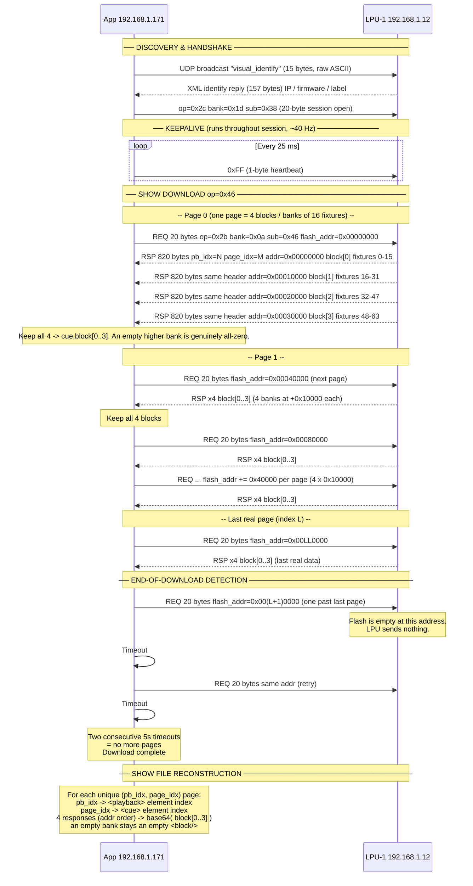

# LPU Show-Download Communication Flow

> **Captures analysed:** `samples/` — `live_lpu_connection_sync_of_show_lpu_memory_to_app.pcapng`,
> `reference_app_show_opening_and_sending_show_to_lpu.pcapng`,
> `samples/show_open_and_download/download_show_M400&12X12 - RGB_dim_shut.pcapng`
> (the capture that proved the 4-block model), and others.
>
> **App:** 192.168.1.171 | **LPU-1:** 192.168.1.12 | **Protocol:** VN over UDP port 16945
>
> **CORRECTION (2026-10):** An earlier version of this document described the four 820-byte
> responses per page as "1 real page + 3 zero retransmits". That was WRONG. The
> `download_show_M400&12X12` capture proves the four responses are the **four blocks (banks)**
> of the cue — block 0 = fixtures 0-15, block 1 = 16-31, block 2 = 32-47, block 3 = 48-63.
> A block that carries no patched fixtures is genuinely all-zero (an empty higher bank), which
> is what made the common "only block 0 has data" case look like retransmits. See section 4.


---

## 1. Full Session Sequence Diagram




---

## 2. Request Packet Layout (App -> LPU, 20 bytes)

| Byte(s) | Field        | Value for op=0x46 download |
|---------|--------------|---------------------------|
| 0       | op           | `0x2b`                    |
| 1       | **req marker** | **`0x1d`** (NOT `0x0a` -- that is the *response* byte[1]) |
| 2       | sub          | `0x46`                    |
| 3       | reserved     | `0x00`                    |
| 4-5     | reserved     | `0x00 00`                 |
| 6-7     | page_in_pb   | page index within the playback (LE) |
| 8-9     | block        | block (bank) index 0..3 within the page (LE) |
| 10-11   | REQ marker   | `0xff 0xff`               |
| 12-15   | flash_addr   | per-show region base (LE, see section 6 -- NOT 0x00000000) |
| 16-19   | reserved     | `0x00 00 00 00`           |

> **CORRECTION (2026-10):** the earlier version of this table was wrong on three
> points, now confirmed from an app->LPU request-direction capture
> (`analysis/scripts/decode_download_request.py`, M400 run of 180 requests):
> request **byte[1] = 0x1d** (0x0a is the *response* byte[1]); bytes 6-7 carry
> `page_in_pb` and bytes 8-9 carry `block` (they are NOT reserved zeros); bytes
> 10-11 are the `0xff 0xff` REQ marker; and the flash address starts at a
> **per-show region base**, never 0x00000000 (see section 6).

---

## 3. Response Packet Layout (LPU -> App, 820 bytes)

| Byte(s) | Field       | Notes                                      |
|---------|-------------|-------------------------------------------|
| 0       | op          | `0x2b`                                    |
| 1       | bank        | `0x0a`                                    |
| 2       | sub         | `0x46`                                    |
| 3       | reserved    | `0x00`                                    |
| 4-5     | pb_idx      | which playback this page belongs to (LE)  |
| 6-7     | page_idx    | which cue/page within that playback (LE)  |
| 8-11    | reserved    | `0x00 00 00 00`                           |
| 12-15   | flash_addr  | mirrors the requested address (LE)        |
| 16-19   | reserved    | `0x00 00 00 00`                           |
| 20-819  | payload     | 800 bytes of cue data (or zeros)          |

---

## 4. The 4 Responses Are the 4 Blocks (Banks)

Each page request produces **four** 820-byte responses. They are **not** one real
page plus three zero retransmits. They are the **four blocks (banks)** of the cue,
each a 16-fixture slot of the 50-byte record array:

```
REQ addr=0x00000000
  RSP addr=0x00000000 -> block[0]  fixtures  0-15
  RSP addr=0x00010000 -> block[1]  fixtures 16-31
  RSP addr=0x00020000 -> block[2]  fixtures 32-47
  RSP addr=0x00030000 -> block[3]  fixtures 48-63
```

The flash address increments by `+0x10000` per block, so the four responses are
four distinct flash reads at four distinct addresses. A block that carries no
patched fixtures is genuinely all-zero (an empty higher bank) -- which is exactly
why the common "only block 0 has data" case USED to look like retransmits.

**App rule:** keep all four responses (in flash-address order) and map them onto
`cue.block[0..3]`. An empty bank stays an empty `<block/>`.

**Proof (`download_show_M400&12X12 - RGB_dim_shut.pcapng`, LPU -> app):**

- 45 distinct pages, exactly 4 responses each, stride `+0x10000` within every page.
- 54 populated (non-zero) blocks; **all 54 match a `.show` `<block>` byte-for-byte, 0 mismatches**.
- **9 pages carry two or more populated blocks** (block[0] AND block[2] both non-zero,
  e.g. pb=28 page=0, pb=2 page=1, pb=3 page=0). A retransmit scheme could never
  produce a distinct non-zero block[2] -- only the bank model explains it.

---

## 5. End-of-Download Detection

There is **no total-page-count field** and **no ACK/NACK** in the protocol. The only stop signal is silence:

```
App sends REQ for page N+1
  LPU has no flash data at that address
  LPU sends nothing

  App waits 5 s  -->  no response
  App retries REQ
  App waits 5 s  -->  no response

  Two consecutive timeouts = EOF
  App stops the download loop
```

> **Failure ambiguity:** A Wi-Fi dropout on the very last real page looks identical to end-of-show.  
> **Solution (VN_PROTOCOL.md, section 11):** Perform the download **3 times** and use majority-vote  
> per (pb_idx, page_idx): keep the payload that appears in at least 2 of 3 runs.

---

## 6. Flash Address Mapping

> **CORRECTION (2026-10):** the earlier version of this section claimed a
> `0x00000000` base, a `+0x10000` per-block step, and a `0x40000` page stride.
> That was a relative/response-side simplification and is now SUPERSEDED by the
> app->LPU request-direction capture (`analysis/scripts/decode_download_request.py`,
> M400 run of 180 requests). The confirmed model below matches VN_PROTOCOL.md
> section 11 "Flash address model (CONFIRMED)".

The LPU flash is organised in **0x80000-byte per-page regions**, and the base
region is **per show** (it moves with whichever show is loaded):

```
region(linpage) = base_region + linpage * 0x80000
```

Within each 0x80000 region there are **8 sub-slots of 0x10000**. The **first
four** are fire-and-forget metadata queries (NO reply expected); the **last
four** are the cmd-0x46 download blocks (820-byte replies):

| Sub-slot | Flash offset in region | Role |
|---|---|---|
| 0 | region + 0x00000 | metadata query, sub 0x05 (no reply) |
| 1 | region + 0x10000 | metadata query, sub 0x27 (no reply) |
| 2 | region + 0x20000 | metadata query, sub 0x29 (no reply) |
| 3 | region + 0x30000 | metadata query, sub 0x2b (no reply) |
| 4 | region + 0x40000 | download block 0 (cmd 0x46) -- fixtures 0-15 |
| 5 | region + 0x50000 | download block 1 (cmd 0x46) -- fixtures 16-31 |
| 6 | region + 0x60000 | download block 2 (cmd 0x46) -- fixtures 32-47 |
| 7 | region + 0x70000 | download block 3 (cmd 0x46) -- fixtures 48-63 |

So **block n of a page is at `region + 0x40000 + n*0x10000`**, and the page
stride (block 0 -> next page block 0) is **0x80000, NOT 0x40000**. Confirmed
request-address steps:

- within a page the download blocks step `+0x10000` (block -> block);
- from block 3 to the next page's block 0 the step is `+0x50000` (the 0x80000
  region stride minus the 0x30000 offset back into the download half).

**Per-show region bases observed:**

| Show | region base | block 0 (region + 0x40000) |
|---|---|---|
| primary "download current show" capture | 0x04480000 | 0x044c0000 |
| `M400&12X12 - RGB_dim_shut` capture | 0x02160000 | 0x021a0000 |

The addresses are fixed regardless of how many bytes were actually used in each
800-byte block (an empty bank is still read from its address and comes back
all-zero).

> **Do NOT climb open-ended.** There is no total-page-count field, but the real
> app issues a bounded, address-correct set of requests and never reads past the
> show's valid regions. Walking the flash address up indefinitely (waiting for
> "the LPU stops responding") reads unmapped flash and **wedges the LPU
> firmware** -- see VN_PROTOCOL.md section 13. The debug tool now walks a fixed
> linear page plan with a hard cap instead.

---

## 7. Show File Reconstruction

After all pages are collected the app rebuilds the `.show` XML. Each page is the
four addr-ordered responses, written onto the cue's four `<block>` elements in
flash-address order. An empty bank stays an empty `<block/>`:

```
# pages[(pb_idx, page_idx)] = [resp@addr0, resp@addr+0x10000,
#                              resp@addr+0x20000, resp@addr+0x30000]
for (pb_idx, page_idx), responses in sorted(pages.items()):
    playback_elem = show.playbacks[pb_idx]
    cue_elem      = playback_elem.cues[page_idx]
    responses.sort(key=lambda r: r.flash_addr)   # block[0..3] order
    for b in range(4):
        payload = responses[b].payload            # 800 bytes
        if any(payload):                          # populated bank
            cue_elem.block[b].text = base64.b64encode(payload)
        else:                                     # empty higher bank
            cue_elem.block[b].text = ""
```

---

## 8. Verified Capture Statistics

| Capture file                                      | Pages (unique) | Packets | Match |
|--------------------------------------------------|---------------|---------|-------|
| `live_lpu_connection_sync_of_show_lpu_memory_to_app.pcapng` | 28 | 84  | 100% byte-for-byte vs .show XML |
| `reference_app_show_opening_and_sending_show_to_lpu.pcapng` | 54 | 216 | 100% byte-for-byte vs .show XML |
| `show_open_and_download/download_show_M400&12X12 - RGB_dim_shut.pcapng` | 45 | 180 | 54/54 non-zero blocks match; 0 mismatches; 9 multi-block pages |

- Each page = 4 UDP packets = the 4 blocks (banks) of the cue; empty higher banks
  are genuinely all-zero (NOT retransmits -- see section 4).
- Direction: the `download_show_M400&12X12` capture is LPU -> app only
  (192.168.1.12 -> 192.168.1.171); no app -> LPU request packets were captured.
- 100% verification: every non-zero base64 block in the reconstructed XML matched
  the original `.show` file exactly (54/54 blocks, 0 mismatches). The 9 pages that
  carry two or more populated blocks (e.g. pb=28 page=0 with block[0] AND block[2]
  both non-zero) can only be the bank model -- a retransmit scheme could never
  produce a distinct non-zero block[2].


---

## 8b. Show Upload -- the Write Mirror (op=0x2b bank=0x0a sub=0x47, app -> LPU)

The download above (`sub=0x46`, LPU -> app) has a matching **write** counterpart
used when the app OPENS a `.show` file: it pushes every page of that file INTO
the LPU. The sub-type byte (byte[2]) is the read/write discriminator:

| sub (byte[2]) | Direction | Meaning |
|---|---|---|
| `0x46` | LPU -> app | download page (read from flash) |
| `0x47` | app -> LPU | upload page (write to flash) |

The upload frame is also 820 bytes with the same `pb_idx` (bytes 4-5) and
`page_idx` (bytes 6-7) header fields, but it does **not** carry a flash address:
bytes[12:16] are the standard VN `data_length` (0x0320 = 800) + packet counter.
The LPU allocates the flash slot itself; the app identifies the target only by
`pb_idx` + `page_idx` and streams the four blocks in transmit order (block 0..3).

### Proof -- both captures reconciled to the proven roles

Direction established by **source IP** (app = 192.168.1.171, LPU = 192.168.1.12),
the only reliable discriminator -- the bank-bit7 / marker is not, because the
op=0x29 RSP echo also carries bit7 + 0x0000.

| Capture | App -> LPU 820-byte pages | LPU -> App 820-byte pages | Verdict |
|---|---|---|---|
| `open_show__M400&12X12 - RGB_dim_shut.pcapng` | **180** (`sub=0x47`, 45 pages x 4 blocks) | 180 (`sub=0x47` echo) + 191 (`sub=0x46`) | app UPLOADS the opened file |
| `download_show_M400&12X12 - RGB_dim_shut.pcapng` | **0** | 180 (`sub=0x46`, 45 pages x 4 blocks) | app only RECEIVES (download) |

- **OPEN SHOW = upload.** The app is the source of 180 `sub=0x47` write pages
  (45 pages x 4 blocks); the LPU echoes each one back with the same sub byte.
- **DOWNLOAD SHOW = download.** The app sends zero bulk frames; the LPU is the
  source of all 180 `sub=0x46` read pages.

Script: `analysis/scripts/confirm_upload_pages.py`. Full packet layout:
`dled_flutter/VN_PROTOCOL.md` section 12.

---

## 8c. Empty-Cue Skipping -- the Uploader's Page-Selection Rule

The upload is NOT a fixed/maximal page dump. The app transmits a page only for a
cue that has content; a **fully-empty cue (all 4 banks all-zero) is NOT sent**.
Within an emitted page, however, every one of the 4 blocks IS still transmitted
(empty higher banks are zero-filled -- see section 8b).

### Logical argument (app hard limits)

The reference app UI enforces hard limits of **48 cues per playback**, **64 playbacks**,
and **64 fixtures**. The theoretical maximum page count is therefore
`64 x 48 = 3072`. If the app transmitted a fixed/maximal page set (including
fully-empty cues), it would ALWAYS send the same number of pages regardless of
show content. But the captures show **different shows produce different page
counts** (28 / 45 / 54, all far below 3072 -- see section 8), so the app must be
emitting only pages that carry content.

### Proof (`open_show__M400&12X12`, app -> LPU sub=0x47)

`analysis/scripts/confirm_no_empty_cue.py` groups the 180 upload frames by
`(pb_idx, page_idx)` and counts the all-zero blocks per page:

```
app -> LPU upload frames (sub=0x47): 180
distinct (pb, page) pages:           45
expected frames if 4 blocks/page:    180

empty-block histogram (how many of a page's 4 blocks are all-zero):
   2 empty block(s):   9 page(s)
   3 empty block(s):  36 page(s)
   4 empty block(s):   0 page(s)   <- NONE

total populated (non-zero) blocks across all pages: 54
total zero-filled (empty bank) blocks:             126

RESULT: PASS -- every transmitted page has >= 1 populated block.
```

- **No page is 4/4 empty.** Every one of the 45 transmitted pages has at least
  one populated block (36 pages with 1 populated bank, 9 pages with 2). A cue
  with all four banks empty is simply never uploaded.
- The 9 pages with 2 populated blocks are the same multi-block pages the download
  side proves (section 8) -- block[0] and block[2] both non-zero.
- `54 populated + 126 zero-filled = 180` frames, consistent with 45 pages x 4
  blocks: the app skips empty *cues* but never skips empty *banks within* a
  transmitted cue.

### Uploader rule (final)

The complete, implementation-ready form -- concrete app bounds (pb 0..63 /
cue 0..47), the empty-cue skip, the 4-block zero-fill loop, and the exact VN
frame fields:

```
for each playback pb (0..63):
    for each cue page (0..47):
        if all 4 blocks of this cue are empty:
            skip the cue entirely        # part 2 - do not transmit
        else:
            for block b in 0..3:          # part 1 - send all 4, in order
                payload = block[b] or 800 zero bytes   # zero-fill empty banks
                send frame op=0x2b bank=0x0a sub=0x47,
                     pb_idx=pb, page_idx=cue, data_len=0x0320,
                     counter++, payload
```

- **Bounds** `pb 0..63` / `cue 0..47` are the app's hard UI limits (64 playbacks
  x 48 cues = 3072 theoretical pages).
- **Part 2 (skip)**: a cue whose 4 banks are all-zero is never transmitted.
- **Part 1 (emit)**: every other cue sends all 4 blocks in transmit order,
  zero-filling any empty bank with an 800-byte all-zero payload.
- **Frame fields**: `op=0x2b bank=0x0a sub=0x47`, `pb_idx`=bytes[4:6],
  `page_idx`=bytes[6:8], `data_len`=bytes[12:14]=0x0320 (800), `counter`=
  bytes[14:16] (increments per frame). `page_idx` advances only after the 4th
  block of the page is sent.

Script: `analysis/scripts/confirm_no_empty_cue.py`.

---

## 9. Related Files


| File | Description |
|------|-------------|
| `dled_flutter/VN_PROTOCOL.md` | Full VN protocol reference, section 11 = show download |
| `analysis/FINDINGS.md` | protocol findings, sections 14-16 = retransmit & verify |
| `.verorules/skills/pcap-decoder/SKILL.md` | Vero skill for decoding LPU pcap files |
| `analysis/scripts/debug_lpu_discover_v2.py` | Python script that replicates discovery + download |

---

## 10. The 800-Byte LPU Cue Payload Format

> **Important:** The LPU generates **all DMX output itself** from these records.
> The app never sends raw DMX values over UDP — it only uploads the cue definition
> (this 800-byte block) and the LPU uses it to drive its DMX hardware.

### 10.1 Top-Level Layout

A populated block is one **bank** of 16 fixture records, 50 bytes each:

| Byte range | Size (bytes) | Content |
|-----------|-------------|---------|
| 0 – 49    | 50          | Fixture record 0 |
| 50 – 99   | 50          | Fixture record 1 |
| 100 – 149 | 50          | Fixture record 2 |
| ...       | ...         | ... |
| 750 – 799 | 50          | Fixture record 15 |

`800 = 16 x 50` exactly -- **there is no 8-byte header**. Record `i` always starts
at byte `i * 50`. A record maps to a global fixture index by the bank model
(section 4): `global_index = block * 16 + record`. An unpatched index is an
all-zero 50-byte record, so sparse shows leave zero gaps between active records
(see section 10.13).

> **Why the old "8-byte header" was wrong.** The earliest capture
> (`cue_fx_show.show` pb0) showed the first non-zero bytes at absolute offset 8,
> which looked like an 8-byte header. It is not: record 0 starts at byte 0, and
> bytes 0-7 are its **empty Intensity FX slot (0-3) and empty Position FX slot
> (4-7)**. The non-zero data at offset 8 is record 0's **Colour FX slot (8-11)**.
> Record 1's colour slot is therefore at 50+8 = 58 and record 2's at 100+8 = 108 --
> the exact offsets the old doc mistook for "records at 8 / 58 / 108". See
> section 10.8 for the FX-slot proof.

### 10.2 50-Byte Per-Fixture Record Layout (authoritative)

All offsets are **relative to the start of the record** (`record_base = i * 50`).

| Offset | Size | Field | Notes |
|--------|------|-------|-------|
| +00–+03 | 4 | **Intensity FX slot** | `[type, size, speed, phase]` (section 10.8). All-zero = no intensity FX. |
| +04–+07 | 4 | **Position FX slot**  | `[type, size, speed, phase]`. All-zero = no position FX. |
| +08–+11 | 4 | **Colour FX slot**    | `[type, size, speed, phase]`. All-zero = no colour FX. |
| +12–+15 | 4 | Gap / reserved | Zeros in every observed record. |
| +16–+49 | 34 | **Channel region** | Static DMX levels, keyed by the fixture's DMX function codes via `kFunctionOffset`. |

The three 4-byte FX slots at bytes 0-11 are universal and fixed. The 34-byte
channel region at bytes 16-49 is addressed by function code -- but **which** offsets
within it carry meaningful data is **per fixture**, decided by that fixture's own
inline `<fixture profile="...">` hex (see the emphasis box below).

**Channel region offsets (the `kFunctionOffset` map, from `show_loader.dart`):**

| fn code | record offset | channel | fn code | record offset | channel |
|---------|--------------|---------|---------|--------------|---------|
| 0x01 | +16 | Dimmer / Intensity | 0x0C | +36 | Shutter / Strobe |
| 0x02 | +4  | Pan (shares Position slot) | 0x0D | +38 | Gobo 2 |
| 0x03 | +6  | Tilt | 0x0E | +40 | Prism |
| 0x04 | +20 | Red | 0x0F | +42 | Focus |
| 0x05 | +22 | Green | 0x10 | +44 | Zoom |
| 0x06 | +24 | Blue | 0x11 | +46 | Iris |
| 0x07 | +26 | Amber | 0x12 | +48 | Colour temperature |
| 0x08 | +28 | UV / White2 | 0x14 | +8 | Motor (shares Position slot) |
| 0x09 | +30 | Colour wheel | 0x21 | +5 | Pan fine |
| 0x0A | +32 | Colour wheel 2 / fine | 0x23 | +7 | Tilt fine |
| 0x0B | +34 | Gobo 1 | 0x80 | +10 | Generic / custom |

> **Note:** a few low function codes (0x02 Pan +4, 0x03 Tilt +6, 0x14 Motor +8,
> 0x21/0x23 fine +5/+7, 0x80 +10) map into the byte range the FX slots also occupy
> (0-11). That overlap is unresolved and is flagged honestly in
> `dled_flutter/SHOW_RECORD_MAP.md` and `dled_flutter/SHOW_FORMAT.md`; it is NOT
> resolved here. The reliably-verified channel offsets are the >=+16 colour/dimmer
> group (Dimmer +16, Red +20, Green +22, Blue +24, ...).

> **CHANNEL DECODING IS PER-FIXTURE.** The `kFunctionOffset` map above is universal
> (e.g. Red is always at +20), but a fixture only has data at the offsets for the
> function codes **it actually exposes**, and that set comes from the fixture's own
> profile hex. `show_loader.dart` proves it: it iterates
> `for (final fnCode in fixture.functionCodes) { final offset = kFunctionOffset[fnCode]; ... }`
> -- only the codes present in that one fixture's inline `<fixture profile="...">`
> are read. `m400_12x12_rgb_dim_shut.show` is the clincher: two different profiles
> coexist in the same show -- Showtec `010405060C` (5 channels: Dimmer/R/G/B/Shutter)
> and Shehds `020301040506080C1480121313222380` (16 channels incl. Pan/Tilt/Amber/
> White/Gobo/...) -- so the SAME 50-byte record layout is decoded with a DIFFERENT
> set of active offsets per fixture. There is no single global channel map; the
> profile is the key.

### 10.3 Worked Example -- cue_fx_show.show pb0 (Rainbow Colour FX)

The three fixtures of `cue_fx_show.show` pb0 (records 0, 1, 2 at bytes 0, 50, 100)
carry a Rainbow colour FX. Reading each record's Colour FX slot (+8..+11):

| Record | base | Colour slot (+8..+11) | Decoded |
|--------|------|-----------------------|---------|
| 0 | 0   | `0a 2f 0d 48` | Rainbow(0x0A), size 0x2F, speed 0x0D, phase 0x48 |
| 1 | 50  | `0a 2f 0d 90` | same FX, phase 0x90 |
| 2 | 100 | `0a 2f 0d d8` | same FX, phase 0xD8 (last fixture, max) |

The Intensity slot (+0..+3) and Position slot (+4..+7) of every record are all-zero
(no intensity/position FX) -- those eight zero bytes at the head of record 0 are the
"header" the old model misread (section 10.1). The phase byte fans
`0x48 -> 0x90 -> 0xD8` (72, 144, 216) across the three fixtures, the spatial phase
spread of section 10.10.

### 10.4 Hex Evidence (reinterpreted)

The raw hex for `cue_fx_show.show`, read under the authoritative layout (records at
0 / 50 / 100; Colour FX slot at record+8):

```
cue_fx (Rainbow colour FX) -- record 0 at byte 0
0000  00 00 00 00  00 00 00 00  0a 2f 0d 48  00 00 00 00   <- +0 Int(empty) +4 Pos(empty) +8 Colour=0a2f0d48
0010  ... channel region (bytes +16..+49) ...
      record 1 at byte 50 (0x32): +8 Colour = 0a 2f 0d 90
      record 2 at byte 100 (0x64): +8 Colour = 0a 2f 0d d8
```

An all-white static cue (`cue_2`) instead carries its levels in the channel region
(bytes >= +16), with all three FX slots zero. The bytes the old doc labelled
"Const A `0x60 0x73`" / "Const B `0x81 0xc4`" fall inside the channel region and are
channel/level data for the fixture's profile, not record metadata.

---


### 10.8 Revised 50-Byte Record Structure (FX-aware)

The FX slot occupies **4 bytes** within each 50-byte record. Its position depends on the mode /
playback type:

| Offset within record | Field | Mode A (pb0/pb8) | Mode B pb1 | Mode B pb2 |
|---------------------|-------|-----------------|------------|------------|
| +00–+03 | **FX slot** | FX params (color FX) | — (zeros) | FX params (intensity) |
| +04–+07 | **FX slot** | — (zeros) | FX params (position FX) | — (zeros) |
| +08–+11 | Reserved / slot ID high bytes | zeros | zeros | zeros |
| +12–+21 | Channel data | 10 bytes (5 x uint16 channel pairs) | channel data | channel data |
| +22–+23 | Const A | `0x60 0x73` | varies | varies |
| +24–+25 | Zeros | `0x00 0x00` | zeros | zeros |
| +26–+27 | Const B | `0x81 0xC4` | varies | varies |
| +28–+49 | Reserved | zeros | zeros | zeros |

**FX slot format (4 bytes) -- proven order `[type, size, speed, phase]`:**

```
byte +0: fx_type   -- FX type ID (0x00 = no FX; see Section 10.9)
byte +1: size      -- FX size    (0x80 = 128 color/position, 0x7F = 127 intensity at mid-scale default)
byte +2: speed     -- FX speed   (0x81 = 129 approx. neutral; 0x80 = 128 is the 0% centre)
byte +3: phase     -- Phase offset for this fixture (see Section 10.10)
```

**Static cues** (no FX) have `fx_type = 0x00` and all four FX bytes are `0x00 0x00 0x00 0x00`.

> **Byte-order proof (`fx_rainbow_size=18_speed=10_phase=85_record.pcapng`).** A Rainbow
> (colour) FX recorded with the app sliders **size=18 %, speed=10 %, phase=85 %** produces the
> colour slot `0a 2f 0d {48,90,d8}` across its three fixtures:
> +0 = `0x0A` Rainbow type; **+1 = `0x2F` = 47 = 47/255 = 18 %** = the SIZE slider; **+2 = `0x0D` =
> 13 = ~10 %** = the SPEED slider; **+3** fans `72 -> 144 -> 216`, last = `0xD8` = 216 = 85 % = the
> PHASE slider. The `[type, size, speed, phase]` order is therefore `+1 = size` and `+2 = speed` --
> matching `SHOW_RECORD_MAP.md`, `PLAYBACK_CUE_OPTIONS.md` and `SHOW_FORMAT.md`. An earlier
> revision of this section had `+1`/`+2` swapped (speed/size); that was wrong and is now corrected.

---

### 10.9 Complete FX Type ID Table

All FX type IDs observed across `cue_fx_show.show`:

| fx_type | Hex | Playback | FX name |
|---------|-----|----------|---------|
| 0       | `0x00` | all | None (static) |
| 1       | `0x01` | pb2 | Sine (intensity) |
| 4       | `0x04` | pb1 | Square (position) |
| 5       | `0x05` | pb0, pb1 | Random |
| 6       | `0x06` | pb1 | Circle (position) |
| 7       | `0x07` | pb1 | Eight (position) |
| 8       | `0x08` | pb1 | Pan (position) |
| 9       | `0x09` | pb1 | Tilt (position) |
| 10      | `0x0A` | pb0 | Rainbow (color) |
| 11      | `0x0B` | pb0 | Full Sines (color) |
| 12      | `0x0C` | pb0 | Full Twinkle (color) |

> **IDs 2 and 3 (now observed).** `cue_fx_show.show` did not exercise them, but
> `show_all_fx_options.show` proves them as **Intensity FX**:
> `2 = Ramp`, `3 = Inversed Ramp`.
>
> **FX IDs are category-specific:** the same numeric `fx_type` means a different
> waveform depending on which of the three FX slots (Intensity / Position /
> Colour) carries it. The table above lists each ID under the playback where it
> was captured; the authoritative per-category mapping (proven from
> `show_all_fx_options.show`) is:
>
> | ID | Intensity FX  | Position FX | Colour FX    |
> |----|---------------|-------------|--------------|
> | 0  | None          | None        | None         |
> | 1  | Sine          | -           | -            |
> | 2  | Ramp          | -           | -            |
> | 3  | Inversed Ramp | -           | -            |
> | 4  | Square        | Square      | -            |
> | 5  | Random        | Random      | Random       |
> | 6  | -             | Circle      | -            |
> | 7  | -             | Eight       | -            |
> | 8  | -             | Pan         | -            |
> | 9  | -             | Tilt        | -            |
> | 10 | -             | -           | Rainbow      |
> | 11 | -             | -           | Full Sines   |
> | 12 | -             | -           | Full Twinkle |
>
> Cross-referenced in `dled_flutter/SHOW_FORMAT.md`,
> `dled_flutter/PLAYBACK_CUE_OPTIONS.md` and `dled_flutter/SHOW_RECORD_MAP.md`.

---

### 10.10 Phase Distribution Formula

When an FX is active across N fixtures, the LPU distributes phases evenly so effects are spread
across the rig:

```
For fixture i  (i = 0 .. N-1):
    phase[i] = floor(255 * (i + 1) / N)
```

The last fixture (i = N-1) always evaluates to exactly `0xFF` (255).

**Examples:**

| N fixtures | Phases (hex) | Phases (dec) |
|-----------|-------------|-------------|
| 2 | `7F FF` | 127, 255 |
| 3 | `55 AA FF` | 85, 170, 255 |
| 6 | `2A 55 7F AA D4 FF` | 42, 85, 127, 170, 212, 255 |

**Exceptions — no phase spread (all fixtures get `0xFF`):**
- FX type `0x05` **Random** — all phases `0xFF`
- FX type `0x0C` **Full Twinkle** — all phases `0xFF`

These FX types are inherently stochastic; distributing phase offsets would have no effect.

---

### 10.11 Per-Playback-Type Summary

| Playback | Layout mode | Header offset | FX slot at | FX size byte (+1) | FX IDs observed |
|----------|------------|---------------|-----------|-------------------|----------------|
| pb0 color FX | Mode A | 8 | record +0 | `0x80` | 0x00, 0x05, 0x0A, 0x0B, 0x0C |
| pb1 position FX | Mode B | 0 | record +4 | `0x80` | 0x00, 0x04, 0x05, 0x06, 0x07, 0x08, 0x09 |
| pb2 intensity FX | Mode B | 0 | record +0 | `0x7F` | 0x00, 0x01 |
| pb8 static color | Mode A | 8 | record +0 | `0x00` (no FX) | 0x00 only |

The FX slot position (record +0 vs record +4) is fixed per playback type regardless of
whether an FX is actually active. Static cues (`fx_type = 0x00`) still occupy those 4 bytes;
they just carry all zeros.

> **Column note:** the tabulated byte is the record's **`+1` = SIZE** byte (proven order
> `[type, size, speed, phase]`, Section 10.8), NOT the speed byte. An earlier revision labelled
> this column "FX speed byte"; that was the swapped-order mistake and is corrected here.


---

### 10.12 pb2 Intensity FX Specifics

The intensity FX playback (pb2) differs from pb0/pb1 in two ways (byte positions
use the proven FX-slot order `[type, size, speed, phase]`, Section 10.8):

1. **The `+1` SIZE byte is `0x7F` (127)**, not `0x80` (128).  All colour and position FX
   carry `0x80` (128) in that slot.  (An earlier revision mislabelled `+1` as the "speed
   byte"; it is the SIZE byte -- see Section 10.8.)
2. **Only one FX type observed:** `0x01` (Sine wave).  The UI may offer more, but only Sine
   appeared in the analysed show file.

All other rules (Mode B layout, phase formula, and the `+2` SPEED byte = `0x81` = 129)
apply identically.

**pb2 example — 6 fixtures, Sine FX:**

```
Fixture  Offset  FX slot (+0..+3)  Phase (dec)
-------  ------  ----------------  -----------
idx=0       0    01 7f 81 2a        42
idx=1      50    01 7f 81 55        85
idx=2     100    01 7f 81 7f       127
idx=8     400    01 7f 81 aa       170
idx=9     450    01 7f 81 d4       212
idx=10    500    01 7f 81 ff       255
```

---

### 10.13 M400 Multi-Fixture Layout (Non-Contiguous Indices)

`m400_12x12_rgb_dim_shut.show` uses two fixture types with a gap in their index assignments:

| Fixture type | Global indices | DMX addresses | Profile bytes |
|-------------|---------------|--------------|--------------|
| Showtec Spectral M800 Tour | 0, 1, 2, 3, 4 | 1, 6, 11, 16, 21 | `01 04 05 06 0C` |
| Shehds LED BEAM 12x12W RGBW | 8, 9, 10, 11 | 30, 46, 62, 78 | `02 03 01 04 05 06 08 0C 14 80 12 13 13 22 23 80` |

Fixture indices 5, 6, 7 are **absent** (no fixture assigned to those slots).
All eleven fixtures fit in bank 0 (index < 16), so they live in block[0];
`global_index = block * 16 + record`, and for block 0 the record number IS the
global index.

**Record placement rule (no 8-byte header -- section 10.1):**

```
record_offset = record * 50
```

Record `i` starts at byte `i * 50`; there is no header, and the gap indices are
NOT packed out -- an absent fixture (5, 6, 7) is simply an all-zero 50-byte
record in its own slot:

| record | Record offset | Content |
|--------|--------------|---------|
| 0 | 0 | M800 Tour #0 |
| 1 | 50 | M800 Tour #1 |
| 2 | 100 | M800 Tour #2 |
| 3 | 150 | M800 Tour #3 |
| 4 | 200 | M800 Tour #4 |
| **5** | **250** | **all zeros (no fixture)** |
| **6** | **300** | **all zeros (no fixture)** |
| **7** | **350** | **all zeros (no fixture)** |
| 8 | 400 | 12x12W #0 |
| 9 | 450 | 12x12W #1 |
| 10 | 500 | 12x12W #2 |
| 11 | 550 | 12x12W #3 |
| 12-15 | 600-750 | zeros (unused) |

The last active record ends at offset 550 + 50 = **600**; bytes 600-799 are all zeros.

**Channel data observed (cue[0] 'cue_0' -- all fixtures).** The earlier revision
of this section read these bytes against a record that (wrongly) started at
absolute byte 8, and so labelled them "rec +8/+9". With no header, record 0
starts at byte 0, so those same **absolute bytes 16-17** are record-relative
**+16/+17 = the Dimmer channel region** (`kFunctionOffset` 0x01 -> +16):

```
record +16/+17 = 0xFF 0xFF   (Dimmer at full -- the "dim" of RGB_dim_shut)
record +24/+25 = 0x00 0x00   (Blue off)
```

Both fixture types carry `ff ff` at record-relative **+16** (Dimmer), confirming
the channel region (bytes >= +16) is addressed identically across different
fixture profiles -- Dimmer is always +16 regardless of profile.

**Channel data cue[1] 'cue_1' -- additional channels active:**

```
record +16/+17 = 0xFF 0xFF   (Dimmer full)
record +22/+23 = 0xFF 0xFF   (Green full)
record +24/+25 = 0xFF 0xFF   (Blue full)
```

Three channel pairs are non-zero in cue[1] vs one in cue[0], consistent with a
different colour preset (more channels driven to full). All three fall in the
**>= +16 channel region** (Dimmer +16, Green +22, Blue +24) -- never in the FX
slots at bytes 0-11.

> **Key rule:** The LPU always indexes fixture records by **global fixture
> index** (`block * 16 + record`), not by a packed sequential counter. Show
> designers are free to leave index gaps (e.g. to reserve slots for future
> fixtures), and the LPU simply writes an all-zero 50-byte record into those
> gap slots.
